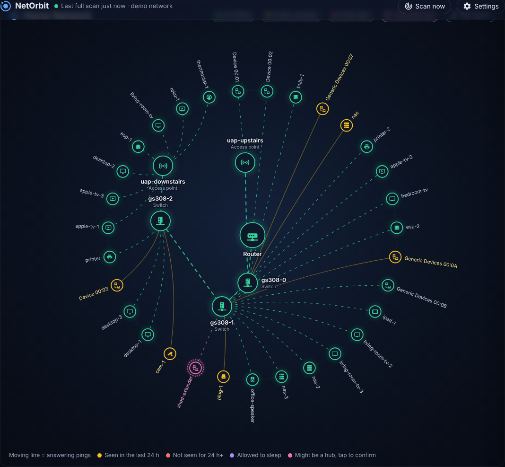

# NetOrbit for Raspberry Pi

A live, radial map of your home network that runs on a Raspberry Pi. No Home Assistant needed.

Every device orbits the router, switch, access point or mesh node it connects through. Green means it's answering right now, yellow means seen recently, red means gone quiet. Open the map from any browser on your network.

This is a standalone port of [NetOrbit for Home Assistant](https://github.com/the-scott-davis/netorbit). It uses the same discovery and layout engine and the same map card, with its own small web server, settings page, history and notifications in place of Home Assistant's.



## What it does

- **Finds every device.** Sweeps your subnet, learns MAC addresses from the Pi's ARP table, and names devices from your router's local DNS or the name they announce over Bonjour. Otherwise it falls back to the maker ("Apple 28:54"). You can rename anything.
- **Finds your network gear.** Spots routers, switches, access points and mesh nodes from who made them, what they call themselves, what they announce over UPnP and what they answer over SNMP. Obvious ones are added for you; likely ones get a pink ring and a one-tap "It's a hub / Not a hub".
- **Works out where devices connect** when your network can say: managed switches with SNMP report their MAC address tables, and NetOrbit works out which port, and so which access point, each device is behind.
- **Lets you place the rest:** drag and drop on the map, pick a hub in Settings, or paste a client list copied from an access point's web page or a mesh app.
- **Remembers history.** Tap any device to see when it came and went and how much of the time it was online.
- **Tells you about changes.** A phone notification through [ntfy](https://ntfy.sh), or a webhook to Node-RED, n8n, Home Assistant or anything else, when a new device joins or one goes quiet.
- **Lightweight.** One ping round a minute, one subnet sweep every 5 minutes, one SNMP question per device per hour. It runs happily on a Pi Zero 2 W.

## Install on a Raspberry Pi

You need a Raspberry Pi (Zero 2 W, 3, 4 or 5) running Raspberry Pi OS (Bookworm or newer, Lite is fine) on the network you want to map. A wired connection is best. The Pi can only see devices on its own network, the same one your router hands addresses out on.

```bash
sudo apt install -y git
git clone https://github.com/crofter/Netorbit_rpi.git
cd Netorbit_rpi
sudo ./deploy/install.sh
```

The installer creates a `netorbit` service user, installs NetOrbit into `/opt/netorbit`, and starts it as a systemd service on port 8099. Then open `http://<your-pi>:8099/` in a browser.

On first start NetOrbit reads the Pi's routing table to find your subnet and router, then starts scanning. The map fills in within a minute. If it guessed wrong, fix it under **Settings > Network**.

**Update:** `cd Netorbit_rpi && git pull && sudo ./deploy/install.sh`. Your settings are kept.

**Uninstall:** `sudo ./deploy/uninstall.sh` (add `--purge` to delete your settings too).

### Set a password

Until you set one, anyone who can reach the Pi can see and change the map. Go to **Settings > Password & backup**. Once set, every page needs a login. If you forget it: `sudo netorbit-pi --reset-password`, then `sudo systemctl restart netorbit`.

### Docker

```bash
docker compose up -d
```

The container needs `network_mode: host` (to see the LAN's ARP table) and `NET_RAW` (for ping). Both are in `docker-compose.yml`.

### Try it without a network

```bash
python3 -m netorbit_pi --demo            # a network with three managed switches
python3 -m netorbit_pi --demo unifi      # or: flat, mesh_no_data, snmp_single, snmp_router
```

Demo mode answers from a simulated home network, so it works on any computer with Python 3.11+ and no extra packages. Open http://localhost:8099/.

## Using it

### The map

| Do this | What happens |
| --- | --- |
| Hover a device | IP, MAC, maker, which hub it's on and how it got placed there |
| Tap a device | History: status changes and the share of time it was online |
| **Edit layout**, then drag a device onto a hub | Pins it there. Pinned placement always beats automatic placement |
| **Edit layout**, then tap a device | *Move to*, *Automatic* (hand it back to NetOrbit), *Make it a hub* |
| Tap a pink-ringed device | Confirm or dismiss it as a hub |
| Tap "+N more" | Big networks fold quiet devices into a bubble. Problem devices always stay on the map |
| **Scan now** | Sweep the whole subnet and ask SNMP again right away |

You can tweak the page with URL options: `/?title=Upstairs&show_ip=1&legend=0&hide_sleepy=1&max=120&height=700`.

### Settings

| Tab | What's there |
| --- | --- |
| Network | Subnet, router, automatic or manual tracking, ping and sweep intervals, the "not seen" window, randomized MACs, automatic hubs, grouping by type, SNMP on/off and community |
| Hubs | Possible hubs to confirm or dismiss; add, rename, retype, re-parent or remove hubs |
| Devices | Rename, pick an icon, choose a hub (or *Automatic*), mark "allowed to sleep", stop tracking. In manual mode, new devices wait here to be tracked or ignored |
| Paste a client list | Paste any text with MAC or IP addresses, pick the hub, done |
| Notifications | ntfy topic, webhook, which events, how long to keep history |
| Password & backup | Admin password; download or restore a backup of every name, icon and placement |

**Allowed to sleep** is for TVs, consoles and anything that's often off. They still show their status but never trigger "not seen" notifications.

### Placing devices: what your network can tell NetOrbit

| Your setup | Hubs found | Devices placed under the right hub |
| --- | --- | --- |
| Managed switches with SNMP on | Automatically | Automatically (wired and wireless, through the switch port) |
| UniFi, Omada, other prosumer gear | Suggested or automatic (by maker, name, SNMP) | Automatically if the switches answer SNMP; otherwise by you |
| eero, Google/Nest Wifi, Deco, Velop, Orbi, ISP routers | Suggested | By you: drag and drop, or paste a client list |

How to turn on SNMP on common switches: see the original project's [setup guide](https://github.com/the-scott-davis/netorbit/blob/main/docs/SETUP.md#2-turn-on-snmp-on-managed-switches). NetOrbit only ever reads. It asks every device with the factory `public` community. Your own community is only sent to hubs, suggested hubs and gear from network makers, because SNMP v2c sends it unencrypted.

### DHCP and MAC addresses

Everything (names, icons, placement, history) is keyed by MAC address, so a device that gets a new IP keeps all of it. Hubs follow their MAC to a new IP too. For the tidiest map, give switches, access points and mesh nodes a DHCP reservation in your router. Phones and laptops often use a private (randomized) MAC per network. NetOrbit hides those by default; turn off *Ignore randomized MAC addresses* if you want them.

### Notifications

- **ntfy:** install the ntfy app, subscribe to a hard-to-guess topic such as `my-network-x7k2`, and enter `https://ntfy.sh/my-network-x7k2` in Settings. Self-hosted ntfy works too.
- **Webhook:** NetOrbit POSTs JSON:

```json
{"event": "netorbit_device_stale", "title": "Device not seen", "message": "Printer has not answered for a while 192.168.1.40 (aa:bb:cc:dd:ee:ff)",
 "name": "Printer", "ip": "192.168.1.40", "mac": "aa:bb:cc:dd:ee:ff", "kind": "device", "last_seen": "2026-10-30T07:12:44+00:00"}
```

Events: `netorbit_new_device`, `netorbit_device_stale`, `netorbit_device_recovered`. **Send a test** checks your setup.

## API

Everything the page does goes through a small JSON API, handy for scripts. Changes are POSTs with a JSON body (`Content-Type: application/json`). With a password set, log in first (`POST /api/login {"password": "..."}`) and send the cookie back.

| Endpoint | |
| --- | --- |
| `GET /api/map` | The whole map: hubs, devices, new devices, suggestions |
| `GET /api/state` | Per-node states in the shape the card uses |
| `GET /api/history/<mac or hub:id>?days=7` | Status changes and online share |
| `GET /api/events` | Server-sent events: `update` after every ping round, `netorbit` for new/stale/recovered |
| `GET /api/health` | `{"ok": true}` when scans are working (for monitoring) |
| `POST /api/services/<name>` | The original integration's services: `track_device`, `ignore_device`, `assign_device`, `reset_placement`, `add_hub`, `update_hub`, `remove_hub`, `confirm_hub`, `dismiss_hub`, `import_client_list`, `scan_now`, `export_config`, `import_config`, plus `update_device` |

```bash
curl -s http://pi:8099/api/services/assign_device -H 'Content-Type: application/json' \
  -d '{"device": ["Living room TV"], "hub": "Upstairs AP"}'
```

Devices can be named by MAC, IP or name; hubs by id, name, IP or MAC.

## Differences from the Home Assistant version

| Home Assistant NetOrbit | NetOrbit for Raspberry Pi |
| --- | --- |
| Card on a dashboard | Its own web page (the same card) |
| Configure menu | Settings page |
| Sensors per device, recorder history | History built in (SQLite) |
| Events and blueprints for automations | ntfy and webhook notifications |
| Names from HA's device list, device trackers and Ping sensors | Names from DNS, Bonjour and the maker; rename anything yourself |
| Placement from the UniFi and Netgear integrations | SNMP switch tables, drag and drop, pasted client lists (direct UniFi/Omada controller support is a possible next step) |
| UPnP hints from HA's SSDP listener | Its own UPnP search each sweep |
| Assist / MCP tools for AI assistants | The JSON API above |

Your existing Home Assistant setup can be moved over. Export it through Home Assistant's REST API (with a long-lived access token from your HA profile):

```bash
curl -s -X POST -H "Authorization: Bearer $HA_TOKEN" -H "Content-Type: application/json" -d '{}' \
  "http://homeassistant.local:8123/api/services/netorbit/export_config?return_response" > netorbit-backup.json
```

Then restore `netorbit-backup.json` under **Settings > Password & backup**. Everything is keyed by MAC, so it lines up.

## Troubleshooting

- **"ICMP sockets are not permitted":** NetOrbit can't ping. The systemd service grants `CAP_NET_RAW`. If you run it by hand, either run it with `sudo` or allow unprivileged ping: `sudo sysctl net.ipv4.ping_group_range='0 2147483647'`.
- **Few devices found:** check the subnet in Settings matches your network, and that the Pi is on the main network rather than a guest network or VLAN. Wi-Fi client isolation also hides devices.
- **No switches found:** turn on SNMP on the switch (read-only, v2c) and set the community in Settings if it isn't `public`.
- **Logs:** `journalctl -u netorbit -f`. Add `-v` to `ExecStart` for debug logging.

Data lives in `/var/lib/netorbit`: `config.json` (your settings), `state.json` (what NetOrbit learned), `history.db`.

## Development

```bash
python3 -m venv .venv && . .venv/bin/activate
pip install -e ".[test]"
pytest
python -m netorbit_pi --demo --data-dir ./data -v
```

The tests run NetOrbit against every simulated network shape plus 25 random networks and check the map against the simulator's answer key. They also cover the web API, login, history and notifications.

Layout: `netorbit_pi/coordinator.py` (discovery, detection, layout, status), `netio.py` (everything that touches the network, swappable for `sim.py`), `app.py` (API and settings), `httpserver.py` (a small standard-library HTTP server), `web/` (the map card, a shim that runs it outside Home Assistant, and the settings page).

## Credits and license

MIT. Based on [NetOrbit](https://github.com/the-scott-davis/netorbit) by the-scott-davis. Icons from [Material Design Icons](https://pictogrammers.com/library/mdi/) (Apache 2.0). See `NOTICE`.
